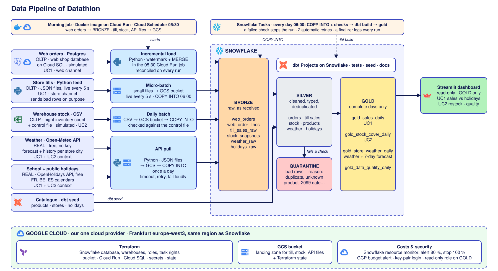

# Datathlon · data pipeline

Group 8 project, *Data Engineering & Cloud Infrastructure*, Albert School. Datathlon is a fictional omnichannel sports retailer; this is its data platform.

**Sources** (web shop, store tills, stock, weather, holidays) → **Google Cloud Storage** → **Snowflake** (bronze → silver → gold, with **dbt**) → **Streamlit** dashboard. Infrastructure in **Terraform**, everything in Frankfurt (`europe-west3`).



**Use cases:** daily omnichannel sales (UC1) and stock cover alert (UC3), see [docs/USE_CASES.md](docs/USE_CASES.md).

## Quick start

```bash
cp .env.example .env                                   # fill in your own values
python3 -m venv .venv && .venv/bin/pip install -r requirements.txt
docker compose --env-file .env -f sources/postgres/docker-compose.yml up -d
```

Load the data, in this order (the stock follows the web and till sales):

```bash
.venv/bin/python sources/postgres/generate_orders.py --init       # web shop history
.venv/bin/python ingestion/incremental_orders/load_web_orders.py  # Postgres -> BRONZE
.venv/bin/python sources/tills/till_feed.py --history             # till files -> GCS
.venv/bin/python ingestion/api_pull/pull_apis.py                  # weather + holidays -> GCS
.venv/bin/python sources/stock/stock_export.py                    # stock files -> GCS
for f in snowflake/stages/0*.sql; do .venv/bin/python snowflake/run_sql.py "$f"; done  # GCS -> BRONZE
dbt/dbt.sh build                                                   # BRONZE -> SILVER / QUARANTINE -> GOLD, tests
```

Every day after that, nothing to type (step 10, D-041): at **05:30** cron starts the Docker morning job (web orders, till, API and stock files, see [orchestration/](orchestration/)), at **06:00** Snowflake Tasks load the files, check them and run dbt inside Snowflake ([snowflake/tasks/](snowflake/tasks/)).

Accounts, keys and sign-ins: [docs/SETUP.md](docs/SETUP.md). Switching everything off: [docs/CLEANUP.md](docs/CLEANUP.md). Next steps (9-12): [docs/HANDOVER.md](docs/HANDOVER.md).

## Repository

| Folder | Contents |
| --- | --- |
| [sources/](sources/) | Simulated company systems and the shared catalogue |
| [ingestion/](ingestion/) | Python jobs that load data into Snowflake |
| [orchestration/](orchestration/) | Docker morning job + cron (outside Snowflake) |
| [snowflake/](snowflake/) | SQL run in Snowflake (setup, stages, Tasks) |
| [dbt/](dbt/) | Transformations and tests |
| [terraform/](terraform/) | Infrastructure as code (Snowflake + Google Cloud) |
| [dashboard/](dashboard/) | Streamlit app |
| [docs/](docs/) | Decisions, journal, build plan, setup |

## Rules

- **Secrets never go in Git** (`.env`, `*.p8`, Terraform state): `.gitignore` blocks them.
- **One login per person**; scripts use key pairs.
- **Changes go through a pull request** on `main`.
- **Every decision** goes in [docs/DECISIONS.md](docs/DECISIONS.md), every action in [docs/JOURNAL.md](docs/JOURNAL.md).

**Team:** Khaled Elnagar, Robin Cacarié, Rudy.
